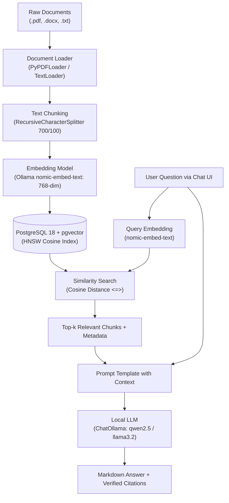

# 🚀 Local Document RAG Assistant (ChatGPT UI + pgvector)

[](https://medium.com/@prince.jose26/how-i-built-a-100-private-enterprise-grade-document-rag-assistant-with-postgresql-pgvector-and-bed2a5f4f066)
[](LICENSE)
[](Dockerfile)
[](https://github.com/pgvector/pgvector)

An enterprise-ready, 100% private **Retrieval-Augmented Generation (RAG)** assistant powered by local LLMs via **Ollama**, dense vector similarity search with **PostgreSQL + pgvector**, and an interactive **ChatGPT-style Web UI**.

> 📖 **Read the full engineering deep-dive on Medium:**  
> [How I Built a 100% Private, Enterprise-Grade Document RAG Assistant with PostgreSQL, pgvector, and Ollama](https://medium.com/@prince.jose26/how-i-built-a-100-private-enterprise-grade-document-rag-assistant-with-postgresql-pgvector-and-bed2a5f4f066)

---

## 📑 Architecture



---

## ✨ Features

- **ChatGPT-Style Web UI**: Polished dark theme interface featuring markdown formatting, message bubbles, and real-time generation.
- **Auditable Citations**: Every answer displays expandable source badges with matching filename, page number, cosine similarity score, and exact excerpt.
- **Drag-and-Drop Document Ingestion**: Upload new PDFs and text files directly from the web sidebar into the vector database.
- **Enterprise Vector Store**: Utilizes PostgreSQL with `pgvector` and HNSW indexing for high-speed approximate nearest-neighbor search.
- **100% Local & Private**: No cloud APIs or data leakage; runs entirely on local hardware via Ollama and Docker.
- **Dual Pipeline Modes**:
  - `rag_postgres.py`: Production-grade PostgreSQL + pgvector pipeline.
  - `rag.py`: Lightweight in-memory FAISS prototype for offline experimentation.

---

## 🛠️ Tech Stack

- **Inference LLM:** Ollama (`qwen2.5:1.5b` / `qwen2.5:3b` / `gemma3`)
- **Embedding Model:** `nomic-embed-text` (768 dimensions)
- **Vector Database:** PostgreSQL 18 + `pgvector` with HNSW cosine indexing
- **Orchestration:** LangChain (`langchain-core`, `langchain-ollama`, `langchain-postgres`)
- **Backend Server:** FastAPI & Uvicorn
- **Containerization:** Docker & Docker Compose

---

## ⚡ Quick Start

### 1. Prerequisites

1. Install and start [Docker Desktop](https://www.docker.com/products/docker-desktop/).
2. Install [Ollama](https://ollama.com/) and pull the models:
   ```bash
   ollama pull nomic-embed-text
   ollama pull qwen2.5:1.5b
   ```

### 2. Deploy with Docker Compose

Run the entire application (PostgreSQL + pgvector + ChatGPT UI) with one command:

```bash
docker compose up -d
```

Open your browser at:
👉 **[http://localhost:8088](http://localhost:8088)**

---

## 💻 CLI Usage (Local Python Execution)

If you prefer running pipelines directly in Python:

### Install Python Dependencies
```bash
pip install -r requirements.txt
pip install faiss-cpu
```

### Option A: PostgreSQL + pgvector Pipeline
```bash
# Initialize schema and HNSW vector index
python rag_postgres.py --init-db

# Ingest document
python rag_postgres.py --ingest company_policy.pdf

# Query with citation output
python rag_postgres.py --query "Explain the authentication policy"
```

### Option B: Quick FAISS Prototype
```bash
python rag.py "Explain the authentication policy"
```

---

## 📡 API Endpoints

| Method | Endpoint | Description |
| :--- | :--- | :--- |
| `GET` | `/api/health` | Checks status of PostgreSQL and Ollama connections |
| `GET` | `/api/documents` | Lists all ingested documents and chunk counts |
| `POST` | `/api/upload` | Uploads and embeds a new document (`.pdf`, `.txt`, `.md`) |
| `POST` | `/api/chat` | Submits user question and returns answer + citations |
| `DELETE` | `/api/documents` | Truncates and resets the vector store |

---

## 📂 Project Structure

```text
├── Dockerfile                  # Container definition exposing port 88
├── docker-compose.yml          # Multi-container orchestration (DB + Chat UI)
├── requirements.txt            # Python dependencies
├── .env.example                # Environment variables template
├── .gitignore                  # Git ignore rules
├── server.py                   # FastAPI backend server
├── rag_postgres.py             # PostgreSQL + pgvector RAG pipeline
├── rag.py                      # FAISS local prototype pipeline
├── create_sample_doc.py        # Generates sample policy documents
├── company_policy.pdf          # Sample company policy document (PDF)
├── company_policy.txt          # Sample company policy document (TXT)
└── static/
    └── index.html              # ChatGPT-style frontend interface
```

---

## 📄 License

MIT License. Free for enterprise and personal development.
